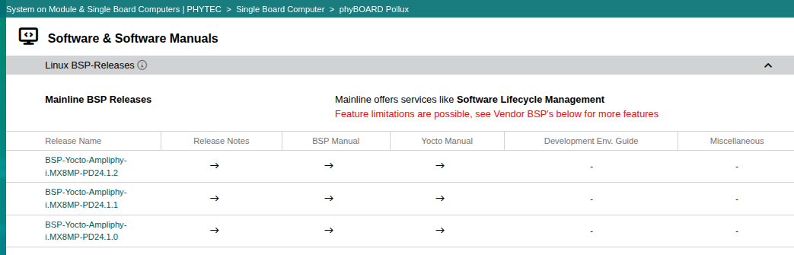
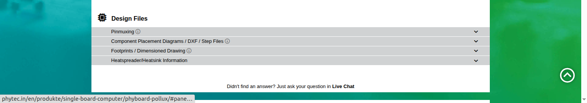

.. START:section:11:0
**Introduction to the BSP**
===========================

.. END:section:11:0

.. START:main_content:11:0
**Purpose of this document**

This document explains common software and hardware-documentation terms shown on PHYTEC product download pages. The exact files and available features depend on the specific PHYTEC product and BSP release. Always select the documentation from the download page for the exact module or board being used.

.. END:main_content:11:0

**Software and BSP terms** 
~~~~~~~~~~~~~~~~~~~~~~~~~~~

**BSP — Board Support Package ** 

A set of board-specific software, metadata, and configuration used to support Linux on a particular PHYTEC product/board. PHYTEC BSP documentation covers tasks such as building the BSP, booting, updating software, device-tree configuration, and accessing peripherals. A BSP integrates the pieces needed for the supported board; it is not just one file.

**Yocto Project / Yocto Manual** 

Yocto is the build framework used to create a customized embedded Linux system. PHYTEC's Yocto Manual explains the Yocto version used by its BSPs, how to install and customize the BSP, and how to use tools such as Poky and BitBake. BitBake executes build tasks based on project metadata.

**Linux kernel** 

The kernel is the core of Linux. It manages hardware resources and provides drivers and interfaces used by applications. In a PHYTEC BSP, kernel sources and configuration are integrated into the BSP build. Device-tree settings describe board hardware so the kernel can configure supported peripherals.

**U-Boot** 

U-Boot is a bootloader commonly used by embedded Linux systems. It performs early boot tasks and loads/starts the Linux kernel with the relevant device tree and boot configuration. PHYTEC BSPs include U-Boot recipes or board-specific bootloader integration where applicable.

**Release Notes** 

Release notes describe a particular BSP release, including changes, fixes, known issues, compatibility information, and other release-specific details. Read them before upgrading or selecting a release.

**Development Environment Guide** 

PHYTEC describes this guide as instructions for working with its prepared virtual-machine development environment, Eclipse and Qt Creator, and/or setting up a Linux host system. It helps developers prepare the tools needed to build and run applications on a PHYTEC product.

.. START:image:11:0:1

   Fig 1 : BSP Release PHYTEC Page

.. END:image:11:0:1

|

.. START:list:11:0:2

.. LIST_META: {"type": "bullet", "head": "", "items": ["|", "**Hardware design and mechanical terms**", "~~~~~~~~~~~~~~~~~~~~~~~~~~~~~~~~~~~~~~~~~", "**PD Design Files / Design Files**", "This is a product-page category for design-related downloads. The exact content depends on the product. PHYTEC product pages may group pinmuxing resources, component-placement diagrams, CAD files, footprints, and dimensioned drawings here. Check the exact product's download section and file descriptions."]}

- |
- **Hardware design and mechanical terms**
- ~~~~~~~~~~~~~~~~~~~~~~~~~~~~~~~~~~~~~~~~~
- **PD Design Files / Design Files**
- This is a product-page category for design-related downloads. The exact content depends on the product. PHYTEC product pages may group pinmuxing resources, component-placement diagrams, CAD files, footprints, and dimensioned drawings here. Check the exact product's download section and file descriptions.

.. END:list:11:0:2

.. START:image:11:0:3

   Fig 2 : Design Files avialibility on website

.. END:image:11:0:3

|

.. START:list:11:0:4

.. LIST_META: {"type": "field", "head": "", "items": ["|", "**Pinmuxing / Pin Muxing Table**", "Pin multiplexing means selecting which supported function a processor pin will perform—for example, a GPIO or a peripheral signal such as UART, SPI, or I²C. PHYTEC says its pin-muxing tables show the default signal path from processor to carrier board and the default device-tree muxing option. Use the product-specific table to check signal routing and possible conflicts.", "phyCORE SOMs include a pin muxing table (in Excel format). This table shows the complete default signal path from the processor to the carrier board. The default device tree muxing option is also included. This gives a designer all the information needed in one place to make muxing changes and design options when designing a custom carrier board or customizing a PHYTEC phyCORE SOM for an application.", "**Component Placement Diagram**", "A drawing that identifies where components are located on the module or carrier board, often with top and bottom views. It helps identify connectors, ICs, and other parts by their reference designators. It is a locating aid, not a full electrical schematic.", "**DXF file**", "DXF is a CAD drawing exchange format used for 2D design information. PHYTEC product documentation points users to CAD data, such as DXF files, for detailed mechanical dimensions where provided. Confirm the drawing units and revision before using it.", "**STEP file**", "STEP is a 3D CAD exchange format. It can be imported into mechanical CAD tools to check the board's shape, component height, connector clearance, and fit in an enclosure. PHYTEC notes that 3D-model accuracy can vary and is not guaranteed; consider component tolerances and contact PHYTEC if tightly controlled height/accuracy is required.", "**Footprints**", "A PCB footprint is the pad and outline pattern used to place and solder a component or module on a printed circuit board. The product-specific footprint information helps a PCB designer place the PHYTEC module correctly on a carrier board.", "**Dimensioned Drawing**", "An engineering drawing with specified physical measurements, such as overall length and width, mounting-hole locations, and connector positions. Use the drawing provided for the exact product and revision when designing a carrier board or enclosure.", "How the software pieces fit together", "• Hardware: the processor, memory, module, carrier board, and peripherals.", "• U-Boot: performs bootloader tasks and starts the operating system.", "• Linux kernel + device tree: the kernel manages resources and drivers; the device tree describes board hardware and configuration.", "• Root filesystem: provides user-space libraries, commands, services, and applications.", "• Yocto: builds the selected software components and configuration into deployable images.", "• BSP: provides PHYTEC-specific integration, metadata, patches, and configuration for the target product.", "• Example: enabling a peripheral", "Note : Use the product's hardware manual and pin-muxing table to identify the correct processor signal and carrier-board connection.", "Check whether the pin is already used by another peripheral and confirm the electrical requirements.", "Use the BSP manual to understand the relevant device-tree and driver configuration.", "Use the Yocto Manual and BSP instructions to rebuild the required software image if changes are needed.", "Read the release notes for known limitations, required patches, and release-specific instructions.", "Use component-placement and mechanical CAD files to identify the connector and verify physical fit when needed.", "**Important notes**", "• Always use documentation for the exact PHYTEC product number and BSP release. Do not assume that a manual or pin table for another module applies.", "• A BSP manual and a Yocto Manual serve different purposes: the BSP manual is product/release specific; the Yocto Manual explains the build system and customization workflow.", "• PHYTEC states that 3D model accuracy may vary and is not guaranteed. Verify critical mechanical dimensions before manufacturing.", "• The Design Files section does not necessarily mean full PCB source files or schematics are publicly available. Check the files actually listed on the specific product page"]}

:|:
:**Pinmuxing / Pin Muxing Table**:
:Pin multiplexing means selecting which supported function a processor pin will perform—for example, a GPIO or a peripheral signal such as UART, SPI, or I²C. PHYTEC says its pin-muxing tables show the default signal path from processor to carrier board and the default device-tree muxing option. Use the product-specific table to check signal routing and possible conflicts.:
:phyCORE SOMs include a pin muxing table (in Excel format). This table shows the complete default signal path from the processor to the carrier board. The default device tree muxing option is also included. This gives a designer all the information needed in one place to make muxing changes and design options when designing a custom carrier board or customizing a PHYTEC phyCORE SOM for an application.:
:**Component Placement Diagram**:
:A drawing that identifies where components are located on the module or carrier board, often with top and bottom views. It helps identify connectors, ICs, and other parts by their reference designators. It is a locating aid, not a full electrical schematic.:
:**DXF file**:
:DXF is a CAD drawing exchange format used for 2D design information. PHYTEC product documentation points users to CAD data, such as DXF files, for detailed mechanical dimensions where provided. Confirm the drawing units and revision before using it.:
:**STEP file**:
:STEP is a 3D CAD exchange format. It can be imported into mechanical CAD tools to check the board's shape, component height, connector clearance, and fit in an enclosure. PHYTEC notes that 3D-model accuracy can vary and is not guaranteed; consider component tolerances and contact PHYTEC if tightly controlled height/accuracy is required.:
:**Footprints**:
:A PCB footprint is the pad and outline pattern used to place and solder a component or module on a printed circuit board. The product-specific footprint information helps a PCB designer place the PHYTEC module correctly on a carrier board.:
:**Dimensioned Drawing**:
:An engineering drawing with specified physical measurements, such as overall length and width, mounting-hole locations, and connector positions. Use the drawing provided for the exact product and revision when designing a carrier board or enclosure.:
:How the software pieces fit together:
:• Hardware: the processor, memory, module, carrier board, and peripherals.
:• U-Boot: performs bootloader tasks and starts the operating system.
:• Linux kernel + device tree: the kernel manages resources and drivers; the device tree describes board hardware and configuration.
:• Root filesystem: provides user-space libraries, commands, services, and applications.
:• Yocto: builds the selected software components and configuration into deployable images.
:• BSP: provides PHYTEC-specific integration, metadata, patches, and configuration for the target product.
:• Example: enabling a peripheral
:Note: Use the product's hardware manual and pin-muxing table to identify the correct processor signal and carrier-board connection.
:Check whether the pin is already used by another peripheral and confirm the electrical requirements.:
:Use the BSP manual to understand the relevant device-tree and driver configuration.:
:Use the Yocto Manual and BSP instructions to rebuild the required software image if changes are needed.:
:Read the release notes for known limitations, required patches, and release-specific instructions.:
:Use component-placement and mechanical CAD files to identify the connector and verify physical fit when needed.:
:**Important notes**:
:• Always use documentation for the exact PHYTEC product number and BSP release. Do not assume that a manual or pin table for another module applies.:
:• A BSP manual and a Yocto Manual serve different purposes: the BSP manual is product/release specific; the Yocto Manual explains the build system and customization workflow.
:• PHYTEC states that 3D model accuracy may vary and is not guaranteed. Verify critical mechanical dimensions before manufacturing.:
:• The Design Files section does not necessarily mean full PCB source files or schematics are publicly available. Check the files actually listed on the specific product page:

.. END:list:11:0:4

.. LIST_META: {"type": "bullet", "head": "", "items": ["**Reference link :**", "BSP Manual : https://phytec.github.io/doc-bsp-yocto/index.html", "Yocto Manual : https://phytec.github.io/doc-bsp-yocto/yocto/scarthgap.html", "Development Env. Guide : https://www.phytec.de/cdocuments/?doc=HQGrO"]}

**Reference link :** 

BSP Manual : https://phytec.github.io/doc-bsp-yocto/index.html
Yocto Manual : https://phytec.github.io/doc-bsp-yocto/yocto/scarthgap.html
Development Env. Guide : https://www.phytec.de/cdocuments/?doc=HQGrO
