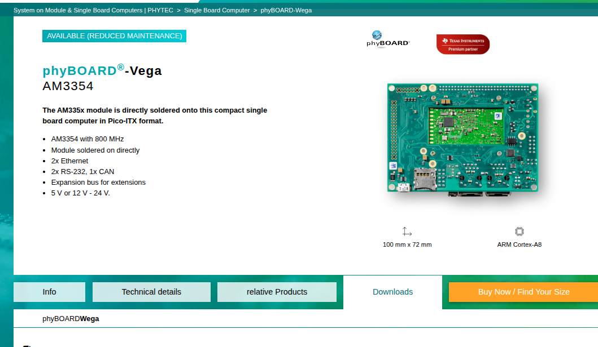
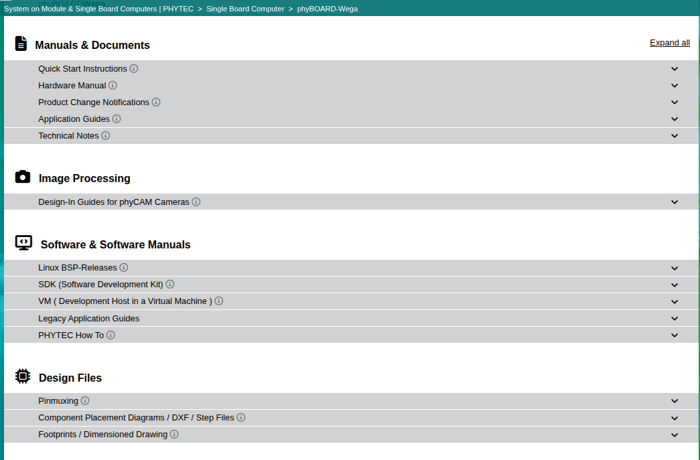

.. START:section:12:0
**BSP Documentation, Downloads and Feature Verification**
=========================================================

.. END:section:12:0

.. START:main_content:12:0
| **Objective**
| To understand how to locate PHYTEC BSP software, review release notes, identify available documentation, and verify peripheral support using official PHYTEC resources.

.. END:main_content:12:0

.. START:image:12:0:0

   Fig 1 : Ex - PhyBoard-Wega page

.. END:image:12:0:0

|

.. START:list:12:0:1

.. LIST_META: {"type": "bullet", "head": "", "items": ["|", "**PHYTEC Product Documentation Navigation and Peripheral Support Verification**", "~~~~~~~~~~~~~~~~~~~~~~~~~~~~~~~~~~~~~~~~~~~~~~~~~~~~~~~~~~~~~~~~~~~~~~~~~~~~~~~~", "**Navigation steps**", "• **Open the product page** : Open the official product page for the exact PHYTEC board you are using.", "• **Go to Downloads:** Locate the Downloads area on the product page. The link above opens the phyBOARD-Wega page at its downloads section.", "• **Open Manuals & Documents:**  Select “Manuals & Documents” to view the documentation listed for that product.", "• **Choose the correct document:** Check the document title, board variant, BSP version, and release information before using it.", "• **Verify applicability:** Make sure the document matches the hardware revision and software/BSP release relevant to your project.", "**Common Documents types:**", "• **Quick Start Guide** - Initial setup instructions, required connections, booting the board, and first-use checks.", "• **BSP Manual** - Board Support Package information, software setup, build or installation workflow, and supported features.", "• **Release Notes -** Release-specific changes, supported components, known issues, fixes, and compatibility notes.", "• **Hardware Manual -** Board architecture, connectors, interfaces, electrical details, and hardware configuration information.", "• **Schematics**  - Circuit-level information used for hardware tracing, signal connectivity, and debugging, when published.", "• **Carrier-board** documentation - Carrier-board connector assignments, interface routing, pin mappings, and related hardware details, when published.", "Document availability and location may vary by product and release. If a document is not present in the selected directory, its availability cannot be confirmed from these two links alone.", "**Step 6** — Identify Board Peripherals and Interfaces", "Use the applicable hardware documentation, when available, to identify the interfaces exposed by the target board.", "Examples of interfaces to investigate include:", "• UART", "• I²C", "• SPI", "• GPIO", "• CAN", "• Ethernet", "• USB", "• PWM", "For each interface, identify the corresponding hardware connection and check whether the BSP release documents any related support or limitations.", "**Step 7** — Verify Peripheral Support", "Use the following procedure to investigate support for a particular peripheral.", "Review the release notes for relevant features, changes, and known issues.", "Check the applicable hardware documentation to confirm that the interface is available on the target board.", "Examine the BSP source code and device-tree configuration, if available.", "Verify that the required Linux kernel driver is present and configured.", "Check the running system for the corresponding device or interface.", "Perform a functional test using suitable hardware and software.", "A peripheral's presence in the processor specification does not guarantee that it is exposed on the carrier board or enabled in the selected BSP configuration.", "**Expected Outcome**", "After completing these steps, the engineer should be able to:", "• Locate the appropriate PHYTEC BSP release.", "• Identify the available software images.", "• Read and interpret the release notes.", "• Identify the relevant hardware documentation.", "• Understand the documented feature changes and known issues.", "• Follow a structured process to verify peripheral support.", "**Conclusion**", "The official PHYTEC Linux download directory is the starting point for locating BSP releases and their associated files. The corresponding release notes provide release-specific information about software versions, tested images, feature changes, and known issues.", "Peripheral support should be confirmed using the applicable hardware documentation, BSP configuration, kernel-driver availability, and practical testing."]}

- |
- **PHYTEC Product Documentation Navigation and Peripheral Support Verification**
- ~~~~~~~~~~~~~~~~~~~~~~~~~~~~~~~~~~~~~~~~~~~~~~~~~~~~~~~~~~~~~~~~~~~~~~~~~~~~~~~~
- **Navigation steps**
- • **Open the product page** : Open the official product page for the exact PHYTEC board you are using.
- • **Go to Downloads:** Locate the Downloads area on the product page. The link above opens the phyBOARD-Wega page at its downloads section.
- • **Open Manuals & Documents:**  Select “Manuals & Documents” to view the documentation listed for that product.
- • **Choose the correct document:** Check the document title, board variant, BSP version, and release information before using it.
- • **Verify applicability:** Make sure the document matches the hardware revision and software/BSP release relevant to your project.
- **Common Documents types:**
- • **Quick Start Guide** - Initial setup instructions, required connections, booting the board, and first-use checks.
- • **BSP Manual** - Board Support Package information, software setup, build or installation workflow, and supported features.
- • **Release Notes -** Release-specific changes, supported components, known issues, fixes, and compatibility notes.
- • **Hardware Manual -** Board architecture, connectors, interfaces, electrical details, and hardware configuration information.
- • **Schematics**  - Circuit-level information used for hardware tracing, signal connectivity, and debugging, when published.
- • **Carrier-board** documentation - Carrier-board connector assignments, interface routing, pin mappings, and related hardware details, when published.
- Document availability and location may vary by product and release. If a document is not present in the selected directory, its availability cannot be confirmed from these two links alone.
- **Step 6** — Identify Board Peripherals and Interfaces
- Use the applicable hardware documentation, when available, to identify the interfaces exposed by the target board.
- Examples of interfaces to investigate include:
- • UART
- • I²C
- • SPI
- • GPIO
- • CAN
- • Ethernet
- • USB
- • PWM
- For each interface, identify the corresponding hardware connection and check whether the BSP release documents any related support or limitations.
- **Step 7** — Verify Peripheral Support
- Use the following procedure to investigate support for a particular peripheral.
- Review the release notes for relevant features, changes, and known issues.
- Check the applicable hardware documentation to confirm that the interface is available on the target board.
- Examine the BSP source code and device-tree configuration, if available.
- Verify that the required Linux kernel driver is present and configured.
- Check the running system for the corresponding device or interface.
- Perform a functional test using suitable hardware and software.
- A peripheral's presence in the processor specification does not guarantee that it is exposed on the carrier board or enabled in the selected BSP configuration.
- **Expected Outcome**
- After completing these steps, the engineer should be able to:
- • Locate the appropriate PHYTEC BSP release.
- • Identify the available software images.
- • Read and interpret the release notes.
- • Identify the relevant hardware documentation.
- • Understand the documented feature changes and known issues.
- • Follow a structured process to verify peripheral support.
- **Conclusion**
- The official PHYTEC Linux download directory is the starting point for locating BSP releases and their associated files. The corresponding release notes provide release-specific information about software versions, tested images, feature changes, and known issues.
- Peripheral support should be confirmed using the applicable hardware documentation, BSP configuration, kernel-driver availability, and practical testing.

.. END:list:12:0:1

.. START:image:12:0:2

   Fig 2: List of documents available in website

.. END:image:12:0:2

|

|

Official PHYTEC References*
~~~~~~~~~~~~~~~~~~~~~~~~~~~

**Reference 1:**  Linux BSP Downloads
https://download.phytec.de/Software/Linux/
**Reference 2:**  AM335x BSP PD23.1.0 Release Notes [ Example for AM335x ]
https://download.phytec.de/Software/Linux/BSP-Yocto-AM335x/BSP-Yocto-Ampliphy-AM335x-PD23.1.0/ReleaseNotes

**PHYTEC Linux BSP Download, Release Identification, and Documentation Review Procedure** 
~~~~~~~~~~~~~~~~~~~~~~~~~~~~~~~~~~~~~~~~~~~~~~~~~~~~~~~~~~~~~~~~~~~~~~~~~~~~~~~~~~~~~~~~~~

**Step 1** Open the BSP Download Directory
Open the official Linux BSP download link provided above.
Review the available BSP directories.
Identify the directory corresponding to the target processor family.
For the AM335x platform, locate BSP-Yocto-AM335x/.
Open the relevant BSP release directory and identify the required version.
The directory contains BSP entries for several processor families, including AM335x, AM62x, AM64x, i.MX6, and i.MX8MP.

**Step 2** — Identify the BSP Release
Open the directory for the required processor family.
Locate the BSP release matching the target platform.
Verify the BSP release identifier.
Confirm that the release corresponds to the intended hardware configuration before selecting an image.
Example BSP: BSP-Yocto-Ampliphy-AM335x-PD23.1.0

**Step 3**  — Review the Release Notes
Open the following official release notes:
https://download.phytec.de/Software/Linux/BSP-Yocto-AM335x/BSP-Yocto-Ampliphy-AM335x-PD23.1.0/ReleaseNotes
Review the information provided in the document.
BSP release information: example link above AM335x
• Release date: 25 April 2023
• Linux kernel: 5.15.82
• Bootloader: barebox 2022.09.0
• Yocto version: 4.0.9 (Kirkstone)
• Qt version: 5.15.7
• Build environment: Ubuntu 20.04, 64-bit
Review these sections:
Tested Yocto Images
Build Environment
New Features
Defeatured
Known Issues
Notes
These sections provide information about tested images, build requirements, feature changes, known limitations, and other release-specific details.

**Step 4** — Identify Image Files
Open the official Linux BSP download directory.
Navigate to the processor family directory.
Open the required BSP release directory.
Review the available files and identify the image format appropriate for the target board.
Refer to the release notes and BSP documentation to confirm the correct image and flashing procedure.

**Step 5**  — Locate Available Documentation
Use the phyBOARD-Wega AM335x product page as an example to check which documentation files are provided.
Example: phyBOARD-Wega AM335x
Product page: https://www.phytec.in/en/produkte/single-board-computer/phyboard-wega-am335x/#downloads/
